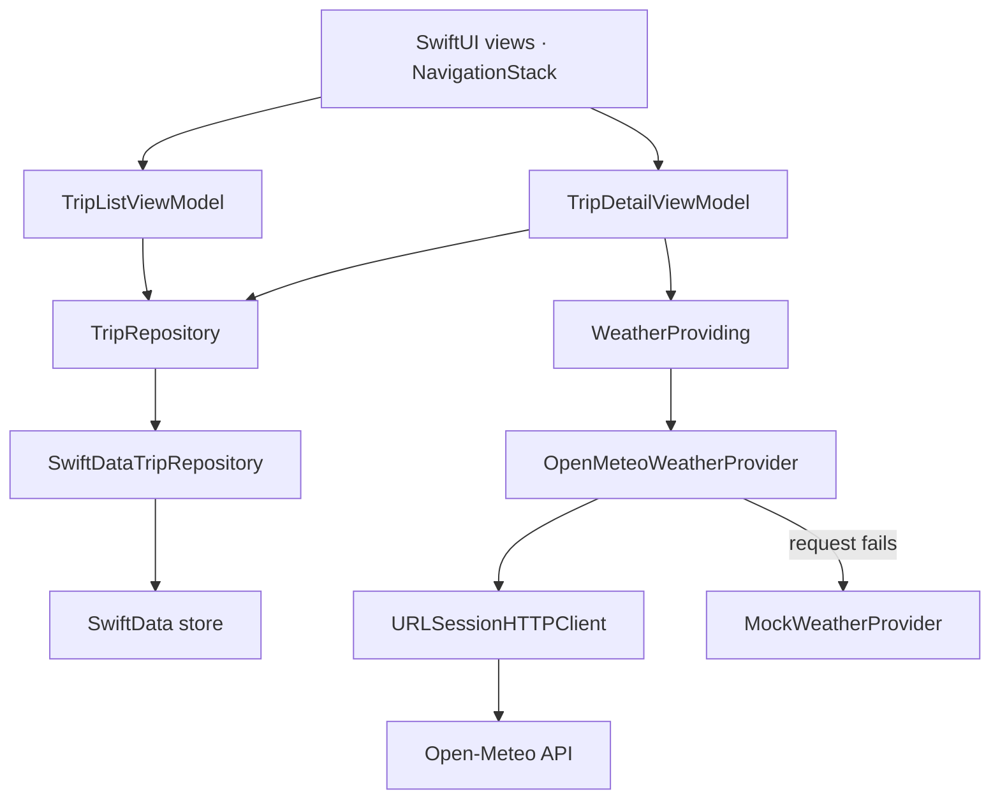

# Northline

Northline is a small iOS dispatch board for a fictional western freight fleet. Dispatchers scan trips, update a status or a note, and check the weather at the destination. It is a portfolio demo for Arpan Bom, a senior mobile engineer.

[](https://github.com/applycoding/ios-swiftui-app/actions/workflows/ci.yml)

## Demo note

This is not a production fleet system. Northline is a fictional carrier, and the six trips on a fresh install are sample data. They are stored on the device with SwiftData, so edits survive a relaunch, but nothing is synced to a carrier, a driver, or a server.

Destination weather comes from the public [Open-Meteo](https://open-meteo.com/) forecast API, which needs no key. If the request fails, the app shows a built-in sample forecast and says so on the trip. There is no live GPS, no accounts, and no claim that the board is connected to real trucks.

## Architecture

The iOS app is a SwiftUI shell. The board's behavior lives in the `FleetLogCore` Swift package so unit tests can run with `swift test` on macOS without launching the app. The package declares a macOS 14 platform for that host, and the app target stays iOS 17.



View models are `@MainActor` and `@Observable`. They depend on `TripRepository` and `WeatherProviding`, not on SwiftData or `URLSession`. The app's composition root builds a `SwiftDataTripRepository` and an `OpenMeteoWeatherProvider` whose fallback is `MockWeatherProvider`. Tests substitute an in-memory repository and a `URLProtocol` stub.

Loading, empty, and failed states are explicit. A failed refresh keeps the trips already on the board and offers a retry. Trip detail keeps a generation token so a slow weather response cannot overwrite a newer one, and cancellation is not treated as a failed forecast.

## Layout

```
Package.swift
Sources/FleetLogCore
  Models            Trip, places, filters, drafts
  Networking        URLSession client, Open-Meteo, sample forecast
  Persistence       SwiftData store and in-memory repository
  ViewModels        Board and trip detail
Tests/FleetLogCoreTests
App                   SwiftUI target
Northline.xcodeproj
.github/workflows/ci.yml
```

## Running the app

Open `Northline.xcodeproj` in Xcode 16 or later, select the Northline scheme, and run it on an iOS 17 simulator. Signing is turned off so the project builds without a development team. Turn automatic signing back on if you want to run it on a device.

The board supports search, status filters, pull to refresh, swipe to delete, and a new-trip sheet. New trips only use the cities in the bundled directory, because those stops have coordinates for the weather request.

## Tests and CI

GitHub Actions runs on `macos-latest`. The workflow selects Xcode, runs `swift test` for the package, and builds the app for the iOS Simulator with signing disabled.

The suite covers:

- board ordering, search, filters, add, and delete
- a failed reload that must not wipe trips already shown
- note and status edits, including a store failure
- Open-Meteo decoding, the request URL, HTTP and decoding failures, and the sample fallback, using `URLProtocol`
- a SwiftData round trip: seed once, update, insert, and delete

```sh
swift test
```
